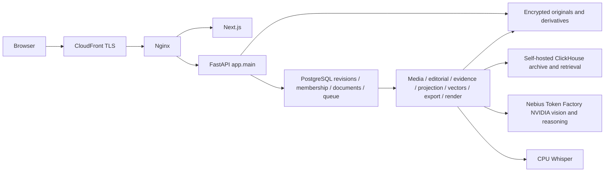

# Trimbin architecture

One browser application at https://trimbin.qleam.com routes through the existing CloudFront TLS distribution to Nginx on a Terraform-managed AWS instance. API and frontend are separate containers; workers run independently on the same host. Scaling and high availability are future work.

The data Docker network has no external route. API and workers needing providers also join an egress bridge. Only the gateway exposes a host port; the security group permits CloudFront origin addresses on port 80. No SSH, database or worker port is public. Browser-to-edge TLS terminates at CloudFront; edge-to-origin currently uses HTTP on AWS networking. This is not an end-to-end private-network or offline claim.

PostgreSQL contains both relational workflow state and retained editorial documents under stable paths. One migration ledger, one membership authority and one durable jobs table replace remote document storage and Pub/Sub. Writes serialize short editorial commands with an advisory transaction lock; revision checks and receipts remain in the retained services. Media publication transactionally enqueues editorial ingestion using the same source UUID. Importing a source does not duplicate footage into an external object store.

Originals are immutable; workers mount them read-only. Derived proxies, sprites, PCM/FLAC audio and model frames are separate. HLS paths require project authorization. Canonical timeline/export references resolve through registered source hashes and verified frame timing. Export/render rehash sources and never substitute a proxy for a missing original.

Self-hosted ClickHouse stores clip/decision/search projections and analysis history. It is not a video decoder or export engine. Fixed queries use the application writer/read connection; model-generated search uses a separately constrained read-only account over HTTP, with server grants, bounded queries and project filtering.

Token Factory is a managed external inference endpoint. Nemotron-3.5-Super-VL reads timestamped frames, Nemotron 3 Super reasons over evidence, and Qwen3-Embedding-8B produces retrieval vectors. Whisper large-v3 runs on CPU for audio. Sparse-frame coverage, ASR uncertainty, provider aliases and unverified comparative quality remain visible. Originals are not uploaded wholesale to Token Factory.

Private credentials live in encrypted SSM and per-service files outside Git. GitHub OIDC can publish exact-commit images and send a release command; the host can read only its runtime parameter and release artifacts. The main-push workflow checks, builds, publishes immutable SHA tags, resolves digests and rolls out through SSM. One production Compose file is shared by preflight and release.

Encrypted EBS persists across container replacement and is protected against Terraform destruction. Daily stopped-writer backups retain PostgreSQL, ClickHouse and originals/exports in private S3. Restore is an explicit operator procedure; this single host is not highly available. See [deployment design](DEPLOYMENT_DESIGN.md).

The browser currently fetches IBM Plex fonts from Google Fonts. This is an additional public web request, not a Google Cloud application dependency or an air-gap guarantee.
