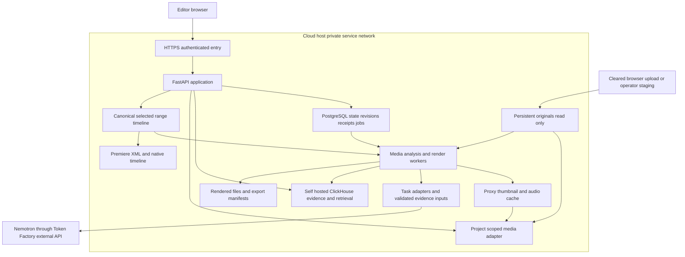

# Proposed architecture

Status: design proposal for phased approval. These components are not yet implemented as a complete migrated system.

## Design priority

Deliver a complete cloud-hosted editorial PoC with a reproducible software package. The experiment addresses the old workflow's provider coupling, unreliable reuse boundaries and missing final delivery. Large-footage transfer constraints motivate future deployment inside a studio network. Actual local installation, offline inference, hardware certification and autoscaling are outside this hackathon. See [product direction](PRODUCT_DIRECTION.md), [submission strategy](SUBMISSION_STRATEGY.md) and [quality gates](QUALITY_STRATEGY.md).

## Runtime profiles and deployment size

- Development: controlled small media, self-hosted services and clearly labeled fixtures when credentials are missing. Fixtures cannot satisfy live release gates.
- Cloud PoC: one host or a small fixed set, persistent media, real Nemotron through Token Factory, functioning web editorial experience and both export paths. Choose the actual host and paid budget during approved deployment work.
- Future studio package: reuse application containers, media-root mapping and operational interfaces with customer storage and an evaluated self-hosted inference endpoint. This profile is a design extension, not a tested installation.

Use a simple Compose-based service package initially. Separate services logically without requiring a separate machine per service. API and workers can share a host with resource/concurrency limits. Kubernetes, automatic node provisioning and sharding are deferred. Persistent database/footage volumes are not disposable application containers.

Terraform owns all new infrastructure and host bootstrap/rollout configuration; Compose runs the versioned workloads on that infrastructure. See [deployment design](DEPLOYMENT_DESIGN.md). Detailed boundaries are specified in the [data contract](DATA_CONTRACT.md), [model contract](MODEL_CONTRACT.md), [export contract](EXPORT_CONTRACT.md) and [workflow design](UX_DESIGN.md).

## Components and network boundary

The upload arrow is a simplified data flow: writable staging validates the file before promoting it into the source registry; analysis/render workers then read originals without modifying them. A visitor's PC path is never treated as an accessible server path. Already-mounted deployment media can be indexed without repeating browser uploads. Preloaded cleared media makes judging practical while the actual ingest route remains demonstrable.

PostgreSQL replaces mutable-state and dispatch responsibilities; a durable job table avoids adding another queue product. Transactional outbox delivery to ClickHouse must not lose human actions. Queue entries carry asset references and job metadata, not full media blobs. Workers process bounded windows and persist completed work.

Only the gateway is exposed to browser traffic. Databases and worker internals use private addresses/service DNS and scoped identities. Token Factory inference is an explicit outbound network dependency, not automatically inside the private network. Optional tracing/search/human-review calls are separately disclosed and disabled without configuration. Record host upload bytes and model input transfers independently; a private service network is not a zero-transfer claim.

## Portability acceptance for this edition

Package source/API/worker/data contracts independently of the cloud host. Verify a clean deployment, persistent restart, changed allowed media-root mapping and changed database/service endpoints using the same build. Record mount permissions, OS/runtime requirements, external dependencies and backup/restore procedures. This demonstrates software deployment portability within the tested environments; it does not certify a local GPU, studio LAN throughput or offline operation. A future hardware bundle requires its own model-license, capacity and quality validation.

## Media identity and precision

Each asset has a stable ID, source fingerprint, root alias plus relative path, measured duration, rational frame rate, source start timecode when present, audio stream layout, orientation and supported color metadata. Absolute host paths must not become permanent global identities or public demo metadata.

A source range uses integer source frames or an equivalent rational timebase, never repeated float rounding. Each timeline occurrence has its own ID; a clip may appear repeatedly. Sequence timebase and source timebase are distinct. Existing second-based fields need an explicit boundary conversion and compatibility tests before a schema change.

Proxy timestamps must map back to source positions. Re-encoding proxy FPS must not silently alter original-frame selection. Original bytes are read-only; derived caches and new exports are written to separate configured roots. Selecting a terabyte directory does not require loading it into memory; scanning, hashing, decoding and inference are bounded jobs with checkpoints.

Low-resolution playback proxies are not assumed sufficient for every analysis task. Read original-detail frames/crops and source audio when slate readability, brief actions, dialogue or continuity evidence requires them. Adaptive analysis must preserve tested coverage and absolute source timing. For future self-hosted inference, model weights and each media chunk must fit the actual memory limits; a large corpus does not become one enormous model request.

## Model responsibilities

Use logical task adapters for identity/slate, observation/audio, comparative reasoning, retrieval planning and embeddings. Share model endpoints across responsibilities where appropriate. Keep time arithmetic, access control, schema validation and export assembly in ordinary deterministic code.

Evaluate Nemotron 3.5 Super VL for image/video/text, Nano Omni for audiovisual work, Ultra for difficult reasoning, Lightning for bounded tools/retrieval, and appropriate audio/embedding models. No endpoint ID is considered account-verified until discovery and a real request succeed. Recheck the model catalog before the evaluation phase. [Current NVIDIA release](https://blogs.nvidia.com/blog/nemotron-3-5-super-vl/).

Model output must resolve to permitted source IDs and valid intervals. New provider schemas are mapped into durable contracts and validated. A task cache includes provider/model revision, prompt version, source identity, evidence version and relevant editor context. Embedding versions use separate corpus/query indexes; existing vectors cannot be reused merely because dimensions match.

Observations, comparisons and draft proposals reuse validated stored evidence; manual playback, timeline changes and rendering do not require a fresh LLM request per interaction. Stronger models or targeted evidence checks may be used for difficult cases, but no untested cheap-model fallback may silently lower quality. A switch between remote and local precision/sampling settings creates a new evaluated configuration.

## Timeline and exports

The same immutable timeline revision drives preview, editable handoff and rendering. It records occurrence IDs, source IDs, source in/out, order, linked audio, basic gain/mute, sequence settings and referenced evidence revisions. Selection-based assembly creates a timeline if one does not exist. AI proposals are separate drafts until the editor accepts them.

Interchange export writes references and timing without encoding media. The initial Premiere path is FCP7 XML with native JSON/OTIO preservation as appropriate. Render export reads original footage, aligns timebases/audio, encodes according to a validated preset and writes to a new destination. An export job pins its timeline and settings so subsequent editing cannot change its output.

Export preflight checks media availability, unchanged fingerprints, readable codecs, interval bounds, free disk space, destination collisions and support for the requested color/audio settings. Unsupported formats produce a clear error rather than an implicit low-quality fallback. A completed job includes output metadata and the originating timeline/build/model references without secrets.

## Retention and recovery

Keep current valid analysis, human decisions, saved timelines and pinned export dependencies. Failed analysis cannot replace the last complete generation. Unreferenced diagnostics, activity and intermediate runs may have bounded retention. Cleanup must trace references before deleting a version. Backups and restore verification cover operational and archive stores together.

## Deployment control

CI on main must run without paid provider keys. Real-model checks are explicit, budgeted integration jobs. The owner explicitly retains automatic deployment on matching main pushes. Current workflows deploy the existing runtime until later cutover; all new infrastructure is Terraform-managed. See [deployment design](DEPLOYMENT_DESIGN.md) for current ownership gaps and the target rollout. Container versions, dependency resolutions, schema migrations and model IDs are recorded. Runtime secrets are injected only into the services that require them and never into a browser bundle.

## Phase 5 implementation update

The dedicated [evidence workspace](EVIDENCE_SETUP.md) now connects registered deployment sources to original-frame analysis, human annotations/corrections/retractions, slate placement, pinned range selection, selected-text comparison/continuity and scoped text/vector retrieval. PostgreSQL owns revisions and jobs; complete ClickHouse snapshots serve retrieval. API and analysis have explicit provider egress in the portable package. Runtime acceptance remains deferred; this is implemented code, not measured model quality or verified deployment. Legacy editorial routes remain transitional. Canonical timeline assembly and both full exports remain later phases.

## Phase 6 implementation update

The [canonical timeline](TIMELINE_SETUP.md) adds source-frame scene/film editing, linked audio metadata, exact saved conform mapping, revision history and approximate browser preview over the portable media path. Existing revision/receipt storage is reused; no new service or AI credential is needed. Runtime and export acceptance remain pending.
