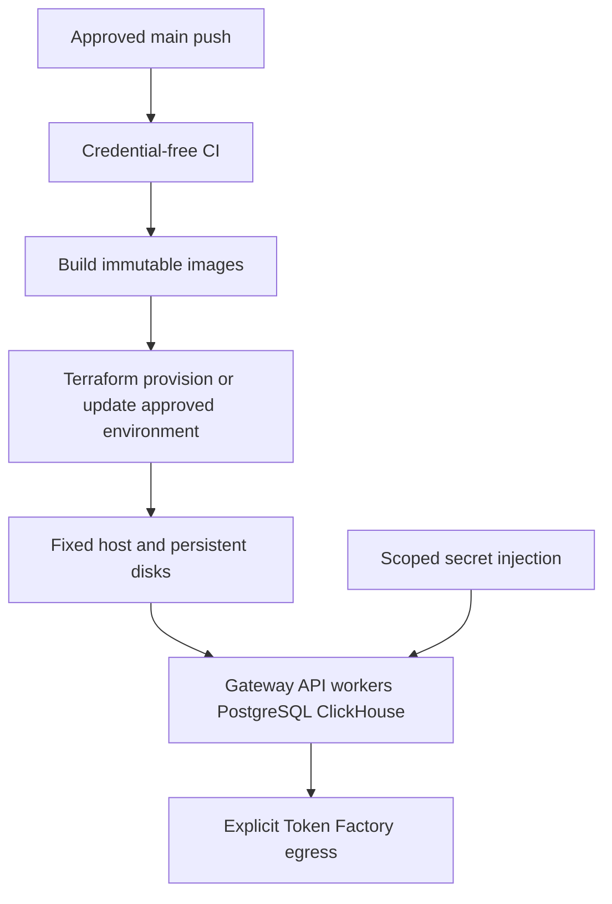

# Terraform and continuous deployment design

Phase 1 decision, 20 October 2026: the owner explicitly requested that pushes continue to deploy automatically and that work stop after pushing, without waiting for deployment. This supersedes earlier planning text proposing deployment-disabled migration.

## Current pipeline retained

CI now runs for every push and pull request, including documentation-only main commits. Backend deployment still calls the same CI as a required gate. Separate concurrency groups prevent a standalone run from cancelling the backend's reusable gate. Some checks run twice on backend-changing pushes; this is intentional until a later unified pipeline can preserve equivalent gates.

Backend deploy triggers on main changes to API, agents, ClickHouse, infrastructure and its workflow. Web deploy triggers on main web/workflow changes and has its existing web checks. Documentation-only changes do not necessarily redeploy either service. This first milestone removes old agent documents, which matches the backend filter. Neither workflow is disabled in Phase 1. Destroy stays manual with typed confirmation; it is never invoked by normal push.

The deployment workflows still operate the existing runtime. Push success is not deployment success. Phase 1 does not poll Actions or wait for its smoke tests.

## Terraform ownership

All new host/network/firewall/disk/IAM/registry/secret-resource infrastructure must be declared in Terraform. Use a remote locked state backend, separate environments, reproducible provider versions, explicit outputs and no credentials in committed variable files. Sensitive Terraform values can still enter state, so state requires restricted access and encryption.

The current GCP code provisions infrastructure through Terraform but ignores container image changes and rolls images/worker command out through `gcloud run deploy`. This is a documented transitional gap, not a claim of full Terraform deployment ownership. Replacing that ownership while replacing the runtime belongs to the approved foundation/cutover work; Phase 1 keeps the requested working deployment path.

Target: Terraform provisions the fixed cloud host and persistent disks/network; a versioned portable service manifest defines API, worker, PostgreSQL, ClickHouse and gateway workloads. Terraform-managed bootstrap/rollout configuration references an immutable application artifact. Compose is the host workload runner, not an alternative cloud provisioning system. Avoid managing the same setting independently in both Terraform and imperative cloud commands.

Build/push immutable images before the runtime rollout step. Bootstrap registry/state creation is distinct from application rollout, avoiding placeholder-image circular dependencies. Pin image digests and record release manifests. Preserve persistent volume identity when updating application containers. No automatic teardown/recreate of data disks on release.

## Network and secrets

Only authenticated HTTPS ingress is public in the target. Databases and workers use private service networking. Originals, derived caches, exports and databases have separate persistent paths and access rules. Token Factory is outbound external traffic. Future studio deployment can reuse the package but needs its own hardware/license/network validation.

Use existing short-lived workload federation where supported. GitHub Secrets hold secret values; Variables hold nonsecret settings. Never put credentials in user data, public browser configuration or logged Terraform outputs. Missing optional inference keys do not fail credential-free checks; a live analysis capability must fail visibly until configured.

## Cutover and recovery gates

Phase 2 supplies service/configuration definitions and Terraform design implementation without silently buying a new host. Actual resource creation requires an approved host/budget. Later phases move data and runtime consumers incrementally. Before cutover: back up, validate restore, prove source/revision integrity, rehearse the deployment and document which old image/schema remains compatible.

Rollback uses recorded compatible image/schema versions and preserved data; a code revert alone cannot undo a destructive migration. Do not delete old services, secrets or data before consumer and rollback audits. No new paid host, resource destruction, live model call or production-data migration occurs in Phase 1.
