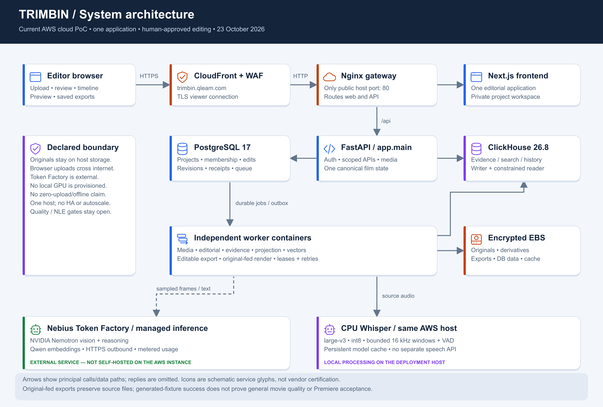
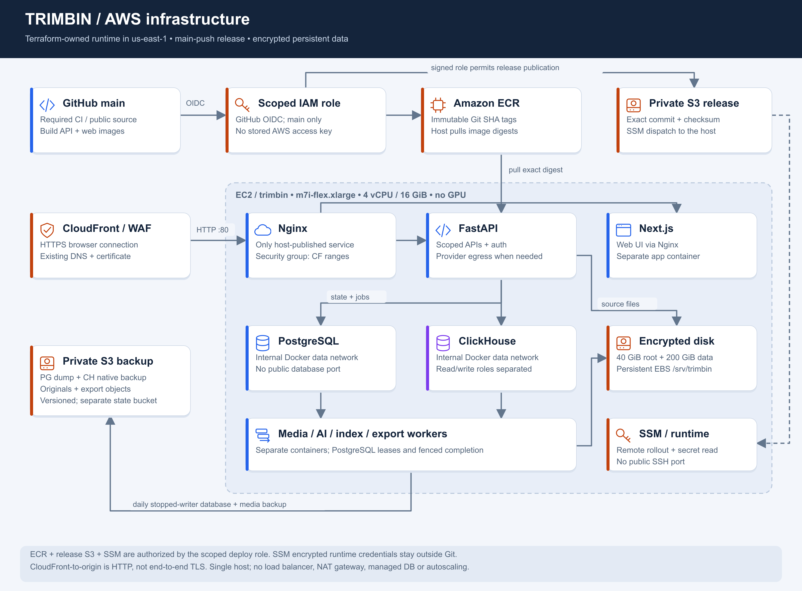
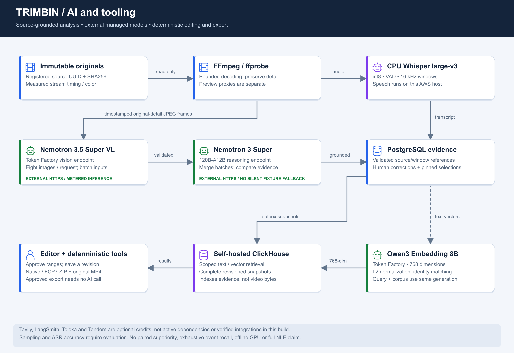
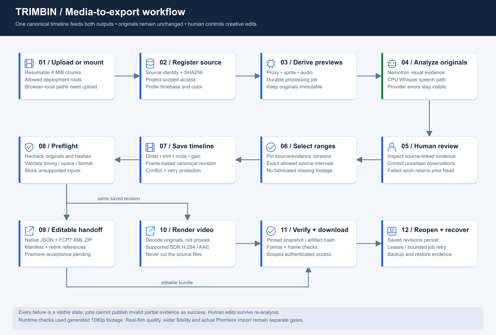

# System design and diagram atlas

Reconciled with the canonical production code on 23 October 2026. These diagrams show the deployed cloud PoC, not a proposed multi-server/Kubernetes installation. Each image is supplied as an editable SVG and a 2x PNG for sharing or submission. Icons are schematic glyphs, not official vendor architecture certification.

## Overall system



[Open PNG](diagrams/system-overview.png) · [Open editable SVG](diagrams/system-overview.svg)

One Next.js application reaches FastAPI through Nginx and CloudFront. PostgreSQL owns project membership, editorial documents, revisions, command receipts, jobs and outbox. ClickHouse holds queryable evidence/history projections. Separate workers share the deployment filesystem and the same identities; there is no parallel GCP-backed editor. Old Film APIs translate to the canonical timeline.

## AWS infrastructure and delivery



[Open PNG](diagrams/aws-infrastructure.png) · [Open editable SVG](diagrams/aws-infrastructure.svg)

Terraform owns the selected AWS network, CPU instance, encrypted disks, IAM/OIDC, registry, buckets, SSM and imported CloudFront configuration. The existing certificate/WAF/domain are retained prerequisites. GitHub main-push CI builds immutable images, publishes an exact-commit source archive, and uses SSM to roll out digests. The instance role reads its runtime configuration and release artifacts and writes backups. PostgreSQL/ClickHouse have no public ports. The production package defines one internal data network and an egress bridge; service-level media mounts and credentials are in [Compose](../deploy/production/compose.yaml).

Browser-to-edge is HTTPS; edge-to-origin is currently HTTP restricted to CloudFront origin address ranges. This does not authenticate just our distribution or provide end-to-end TLS. All application containers currently share one EC2 host: separation of containers is not separate physical fault domains. There is no GPU, NAT gateway, load balancer, managed database, Kubernetes or autoscaling deployment.

## AI and tooling connections



[Open PNG](diagrams/ai-and-tooling.png) · [Open editable SVG](diagrams/ai-and-tooling.svg)

| Component | Actual responsibility | Execution boundary |
| --- | --- | --- |
| FFmpeg / ffprobe | Probe metadata, decode original frames/audio, derive previews, build final render | CPU host; source files remain unchanged |
| NVIDIA Nemotron 3.5 Super VL | Timestamped visual observations and slate/context extraction | Token Factory managed endpoint; eight-image request limit |
| NVIDIA Nemotron 3 Super 120B-A12B | Reason over selected evidence and merge larger frame batches | Token Factory managed endpoint |
| Qwen3 Embedding 8B | Evidence/query vectors; 768 requested dimensions and L2 normalization | Token Factory managed endpoint |
| faster-whisper large-v3 | VAD and speech transcription from source audio in retained editorial analysis | CPU int8 on the AWS host; not a Token Factory speech API |
| PostgreSQL | Authorization, canonical edits, evidence lifecycle, jobs and atomic receipts | Internal container network |
| ClickHouse | Scoped text/vector retrieval and analysis/history projection | Self-hosted container; not video storage, decoding or playback |
| Native/FCP7 exporters | Pin the saved revision, validate originals, package timeline and relink manifest | Deterministic worker; no model call per export |
| Render worker | Original-fed supported SDR MP4, hashes, timing and job publication | CPU worker; not proxy-based final output |
| Tavily / LangSmith / Toloka / Tendem | Optional partner offers; no active core integration claimed | No assumed API expense in the basic scenario |

Originals are not sent wholesale to Token Factory; sampled frames and text still leave the host. Catalog descriptions of direct video support do not mean this adapter sends full movies. Sparse samples cannot guarantee unseen-event recall. Public catalog precision metadata is informational; the earlier preflight run identities conservatively record unpinned aliases/undisclosed serving precision rather than treating metadata as a per-request weight attestation.

## Working flow and human authority



[Open PNG](diagrams/editorial-workflow.png) · [Open editable SVG](diagrams/editorial-workflow.svg)

Upload or register an allowed deployment-mounted source, index it, derive previews, analyze originals, review/correct evidence, select valid ranges and save the canonical scene/film revision. The same saved revision feeds native/FCP7 ZIP and original-fed render jobs. Repeated occurrences are independent; edits made after a job starts do not change its pinned snapshot. Preview is approximate and never substitutes for the original during final render. Missing media or unsupported timing/color blocks delivery instead of inventing footage.

Human decisions survive model re-analysis. PostgreSQL leases and completion fencing prevent an expired worker publishing over recovered work. Outbox/index generation matching prevents stale retrieval from looking like a valid empty result. A failed new generation preserves the last complete evidence. See [data contract](DATA_CONTRACT.md), [model contract](MODEL_CONTRACT.md) and [export contract](EXPORT_CONTRACT.md).

## Recovery, cost and future placement

Daily stopped-writer backups cover PostgreSQL, ClickHouse and deployment originals/exports in private S3. Fresh isolated database containers restored the real generated-fixture state and re-created access roles; full replacement-host disaster recovery is a separate exercise. Schema rollback is not automatic when images roll back. See [deployment/recovery](DEPLOYMENT_DESIGN.md) and [verification](AWS_CUTOVER.md).

The intended future studio installation would place these services beside actual SSD/NAS mounts and, optionally, separately sized model-serving hardware. That installation has not been demonstrated. The current 200 GiB data disk, single CPU host and external inference are not a terabyte-scale or offline benchmark. [Cost estimation](COST_ESTIMATE.md) separates open-source software fees, hosting, storage and metered models.

## Rebuild these images

```powershell
python tools/build_architecture_diagrams.py
# Install the locked web dependencies first if node_modules is absent:
npm --prefix web ci
node tools/render_diagrams.cjs
```

The [SVG generator](../tools/build_architecture_diagrams.py) uses the Python standard library; the [PNG renderer](../tools/render_diagrams.cjs) uses the web application's existing Sharp dependency. Update the actual connection/model/configuration documents and this source together, regenerate all four images and visually inspect them before committing. Prompts under agents are executable model inputs, not historical architecture diagrams; changing them requires separate model evaluation.
