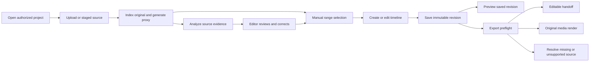

# Editorial workflow design

Phase 1 specification, 20 October 2026. This is the implementation contract for later phases, not a screenshot or evidence of shipped exports. Read [product direction](PRODUCT_DIRECTION.md), [data contract](DATA_CONTRACT.md) and [export contract](EXPORT_CONTRACT.md).

## Workspace structure

Use one project workspace with Media, Review, Timeline and Exports views. Keep project identity, saved revision, source availability and analysis mode visible. A compact job drawer survives navigation. Model/provider details belong in analysis settings and run evidence, not every editing control.

| View | Main interaction | Required states |
| --- | --- | --- |
| Project entry | Open a saved project or a cleared demo; show persistence and access scope | Empty, loading, access denied, service unavailable |
| Media | Upload, select staged assets, or register an operator-authorized mounted root; inspect indexing/proxy/analysis separately | Uploading, resumable interruption, indexing, duplicate, unsupported, missing, ready |
| Review | Source viewer beside observations, transcript, attempts and comparison evidence; clicking evidence seeks its exact interval | Pending, running, complete, uncertain, failed, stale evidence, human-corrected |
| Timeline | Source-range list, preview, ordered occurrences, linked audio controls, save/version selector | Unsaved, saving, saved, conflict, missing source, unsupported conform |
| Exports | Choose saved revision and editable handoff or rendered video; inspect preflight, progress and download | Blocked, queued, running, cancel requested, cancelled, failed, complete |

The media-root picker lists deployment-authorized aliases, not arbitrary server directories. An editor entering `C:\Movies` on a remote browser has not granted the server access to that PC. Explain upload/staging explicitly. A future studio installation could index a mounted shared drive through this same boundary.

## Review and selection

Show source clip, source in/out, evidence confidence/uncertainty, run identity and editor correction status together. Keep technical faults separate from subjective artistic judgments. Let editors reject a finding, correct placement, adjust attempts and select multiple ranges from one source. A failed new run retains the last complete evidence and a visible failed-run notice.

Selected ranges have an explicit order. “Create timeline from selections” previews that order and any omitted/missing sources before saving. With no selections, show the next action rather than exporting an empty movie. Creating a new timeline does not overwrite an existing saved timeline. AI arrangements open as separate proposals with source-linked reasons; acceptance is an editor action.

## Timeline layout and editing

```text
Project / Scene or Film                  Revision 7 · Saved
Source ranges             Preview of selected occurrence
Clip, In, Out             Source time | Sequence time | Audio
Select / Add              Play / Pause / Seek
----------------------------------------------------------------
Ordered timeline: [Occurrence A] [Occurrence B] [Occurrence A again]
Trim In/Out · Move · Remove · Mute · Gain · Undo/Redo
Save revision                            Export saved revision
```

Each repeat is independent. Trimming one occurrence leaves the other unchanged. Display sequence FPS and resolution in settings before first export; mixed-rate conform rules are explicit. Basic editing includes cuts, ordering and linked source audio. Unsupported effects and speed changes are not shown as working controls.

Undo/redo applies to the current unsaved edit session. Saving uses optimistic revision checks. On conflict, preserve the local draft and offer reload or save as a new sequence; never silently overwrite another editor. The UI distinguishes an unsaved preview from a saved export snapshot.

## Export interaction

“Editable timeline” explains that media references must relink to the editor's originals. Offer native JSON alongside FCP7 XML and a relink manifest. “Video” shows output size/FPS, supported color/audio, estimated disk needs and the fact that original footage supplies final frames. Never imply MP4 preserves all camera bits.

If sources are missing, changed or unsupported, show the affected occurrences and block the relevant export. A proxy-only preview can remain available with a clear warning, but must not unlock final render. While exporting revision 7, later edits to revision 8 leave that job unchanged. Completion requires a verified output, not a progress counter reaching 100%.

## Error and recovery behavior

| Event | User-visible response | Recovery |
| --- | --- | --- |
| Provider key/model unavailable | Analysis unavailable; existing work remains accessible | Configure capability, then explicitly retry |
| Unsupported modality or low confidence | Explain unavailable/uncertain evidence | Editor review or validated alternate task configuration |
| Upload interrupted | Retain server receipt and uploaded byte count | Resume matching source or restart explicitly |
| Worker restart | Job recovering, previous completed work retained | Lease recovery and bounded retry |
| Disk shortage | Required operation blocked, originals intact | Free derived space or choose configured output volume |
| Changed source fingerprint | Relink required; old evidence marked stale | Validate replacement and new source version |
| Export cancel | Cancellation requested until worker acknowledges | Remove owned temporary files; preserve completed exports |
| Read-only user | Viewing allowed; mutation controls unavailable | Authorized editor performs change |

Do not silently change model, frame sampling, output resolution or source media to make an error disappear. Keyboard focus, labeled controls, visible progress text and non-color-only statuses are required. Judge access should open cleared media without private user credentials embedded in a public bundle.

## Workflow diagram



Phase 6 validates edit/revision behavior; Phases 7 and 8 independently validate exports. Phase 9 validates the complete journey with actual services.

## Phase 5 implementation update

The dedicated [evidence workspace](EVIDENCE_SETUP.md) now connects registered deployment sources to original-frame analysis, human annotations/corrections/retractions, slate placement, pinned range selection, selected-text comparison/continuity and scoped text/vector retrieval. PostgreSQL owns revisions and jobs; complete ClickHouse snapshots serve retrieval. API and analysis have explicit provider egress in the portable package. Runtime acceptance remains deferred; this is implemented code, not measured model quality or verified deployment. Legacy editorial routes remain transitional. Canonical timeline assembly and both full exports remain later phases.
